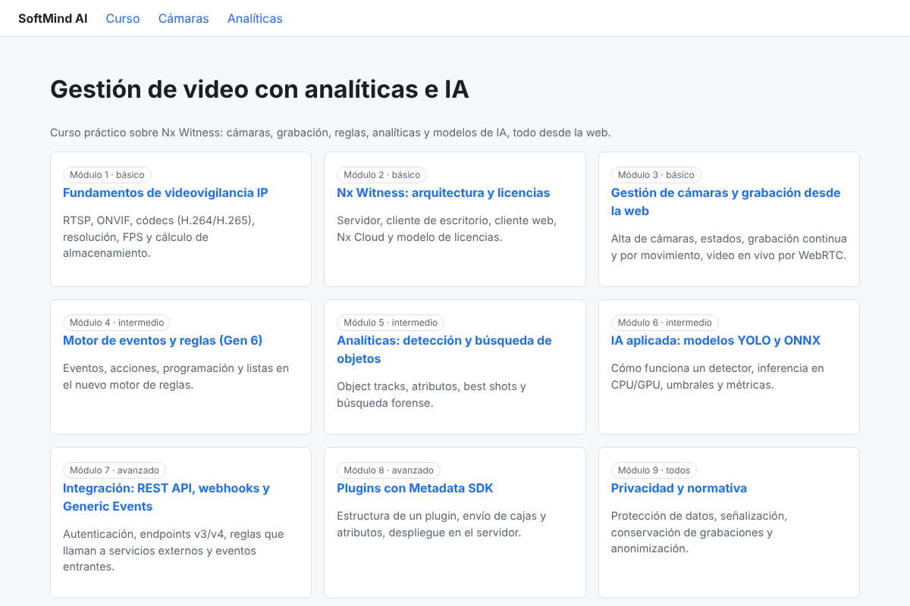

# SoftMind AI

Plataforma web para un **curso de gestión de video con analíticas e IA** sobre el VMS **Nx Witness / Nx Meta**.

Los alumnos siguen los módulos del curso y hacen prácticas desde el navegador: ven cámaras en vivo (WebRTC), consultan objetos detectados y eventos, y conectan modelos de IA propios que disparan reglas en Nx.



## Estructura

| Carpeta | Qué contiene |
|---|---|
| `frontend/` | Next.js 15 (React 19): curso, cámaras con reproductor WebRTC, analíticas |
| `backend/` | FastAPI: intermediario seguro con la REST API de Nx, webhooks, contenido del curso |
| `ai-worker/` | Python + OpenCV + ONNX Runtime: detecta objetos (YOLO) o movimiento y envía eventos a Nx |
| `simulator/` | Convierte videos `.mp4` en cámaras RTSP para el laboratorio |
| `docs/` | Análisis del entorno y capturas |

```
Navegador ──► frontend (Next.js) ──/api──► backend (FastAPI) ──REST──► Servidor Nx
    │                                          ▲                         ▲
    └──── WebRTC (video en vivo) ──────────────┼─────────────────────────┘
                                               │
                         ai-worker ──eventos───┘   (lee RTSP de la cámara)
```

## Modo simulado

Si `NX_URL` está vacío, el backend responde con **datos simulados** (4 cámaras, objetos y eventos). Así se puede desarrollar el frontend y el contenido del curso sin un servidor Nx. El video en vivo solo funciona con un servidor real.

## Arranque rápido (desarrollo local)

Requisitos: Python 3.12+, Node.js 22+.

```bash
cp .env.example backend/.env
```

```bash
cd backend && python3 -m venv .venv && .venv/bin/pip install -r requirements-dev.txt && .venv/bin/uvicorn app.main:app --reload --port 8000
```

En otra terminal:

```bash
cd frontend && npm install && npm run dev
```

Abre http://localhost:3000. La documentación interactiva de la API está en http://localhost:8000/docs.

### Worker de IA

```bash
cd ai-worker && python3 -m venv .venv && .venv/bin/pip install -r requirements-dev.txt
```

```bash
VIDEO_SOURCE=ruta/a/video.mp4 BACKEND_URL=http://localhost:8000 .venv/bin/python worker.py
```

Sin `MODEL_PATH` usa detección de movimiento. Para usar YOLO, exporta un modelo a ONNX (por ejemplo `yolo11n.onnx` con Ultralytics) y define `MODEL_PATH`. Revisa la licencia del modelo que elijas antes de usarlo en el curso.

## Con Docker

```bash
cp .env.example .env
```

```bash
docker compose up --build
```

Perfiles opcionales: `--profile simulator` (cámaras RTSP de prueba) y `--profile ai` (worker de IA).

## Conectar un servidor Nx real

1. Instala Nx Meta (gratis para desarrolladores) o Nx Witness en una VM.
2. Crea un usuario de Nx para la aplicación con los permisos mínimos necesarios.
3. Rellena en `.env`: `NX_URL`, `NX_USERNAME`, `NX_PASSWORD`.
4. Video en vivo (WebRTC):
   - Con **Nx Cloud**: deja `NX_RELAY_URL={systemId}.relay.vmsproxy.com`.
   - **Sin Nx Cloud**: `NX_RELAY_URL=<host-del-servidor>:7001` y `NX_USE_RELAY_PREFIX=false`. Esta variante aún no está probada.
5. Webhooks: en el motor de reglas de Nx, crea una acción "HTTP request" hacia
   `https://<backend>/api/webhooks/nx?secret=<WEBHOOK_SECRET>`.
6. Eventos de IA: crea en Nx una regla con el evento "Generic Event" y fuente `softmind-ai-worker`.

## Tests

```bash
cd backend && .venv/bin/python -m pytest
```

```bash
cd ai-worker && .venv/bin/python -m pytest
```

```bash
cd frontend && npm run typecheck && npm run build
```

## Estado y pendientes

Hecho:
- Backend con cliente Nx (sesión con token, cámaras, miniaturas, objetos, eventos, Generic Events) y modo simulado.
- Frontend con curso (10 módulos), lista y detalle de cámaras, reproductor WebRTC y panel de analíticas.
- Worker de IA (YOLO ONNX o movimiento) que envía eventos con límite de frecuencia.
- Simulador de cámaras y docker-compose.

Pendiente:
- **Probar contra un servidor Nx real.** Los endpoints se basan en la documentación pública de Nx Gen 6 y deben verificarse.
- Usuarios del curso y progreso (PostgreSQL), y un token de Nx por alumno. Hoy el backend entrega su propio token al navegador para WebRTC.
- Guardar los webhooks en base de datos (hoy se guardan en memoria).
- Redactar el contenido teórico de cada módulo.
